.. -----------------------------------------------------------------------------
   ..
   ..  Filename       : index.rst
   ..  Author         : Huang Leilei
   ..  Status         : phase 000
   ..  Created        : 2026-09-17
   ..  Description    : description about 第12讲 - 帧内预测 - 基本原理
   ..
.. -----------------------------------------------------------------------------

第12讲 - 帧内预测 - 基本原理
--------------------------------------------------------------------------------

导入
........................................
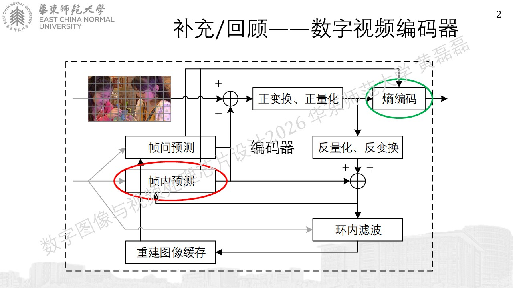
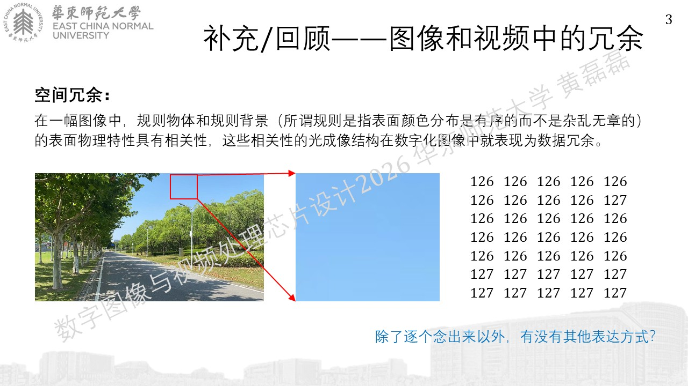

空间域统计特性
........................................
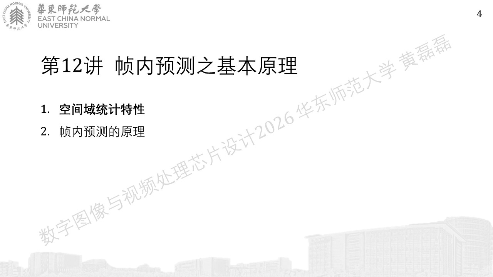
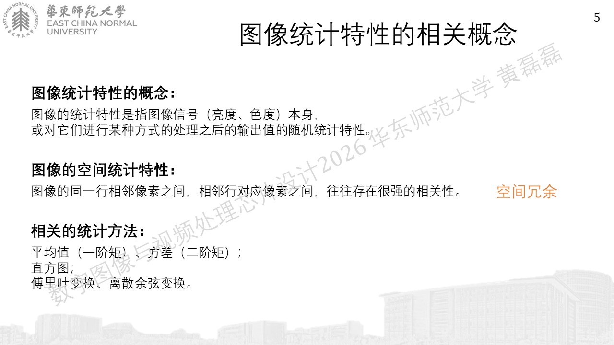
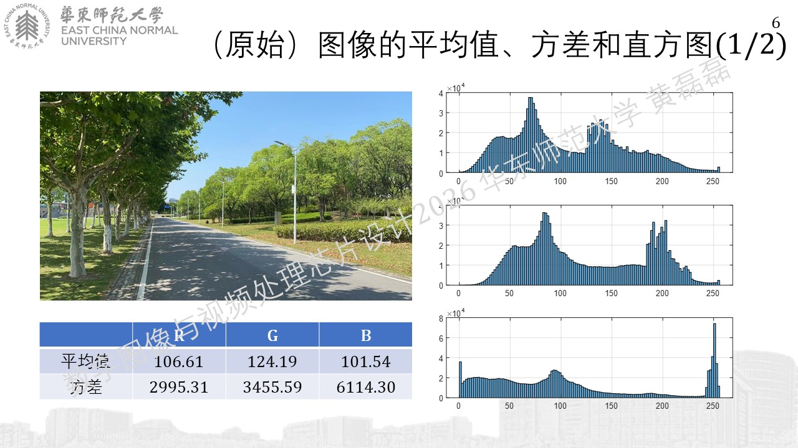
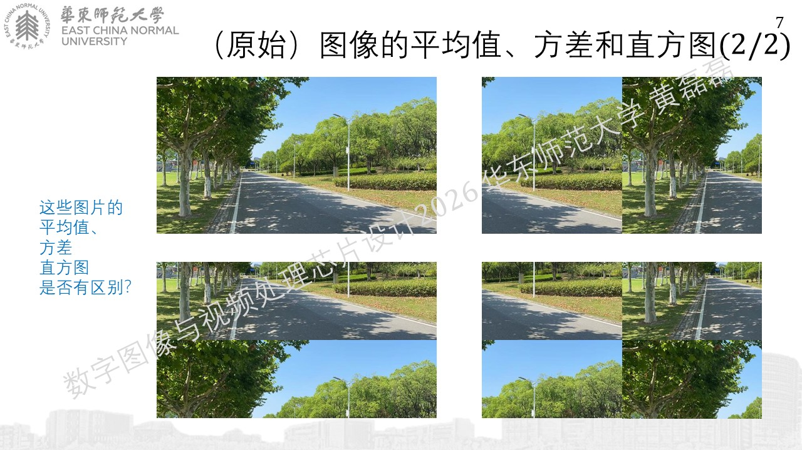
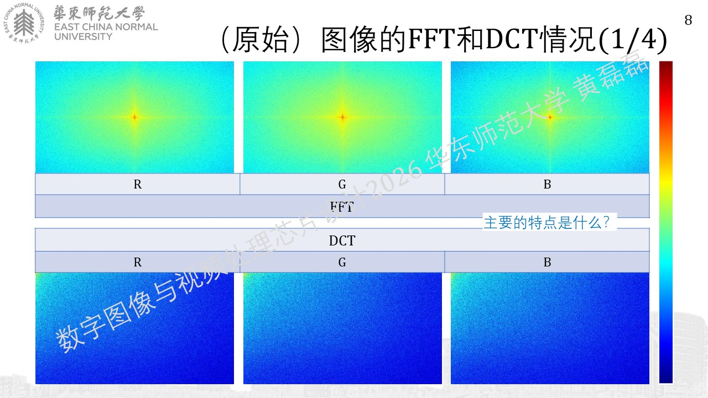
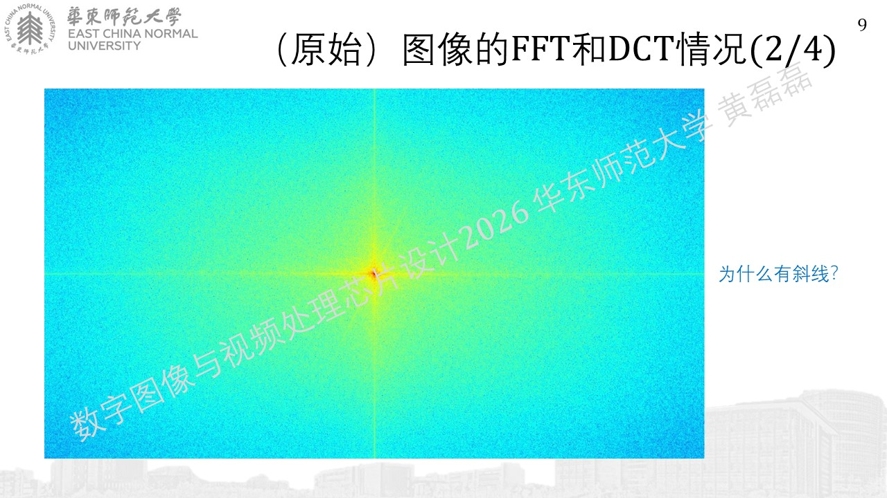
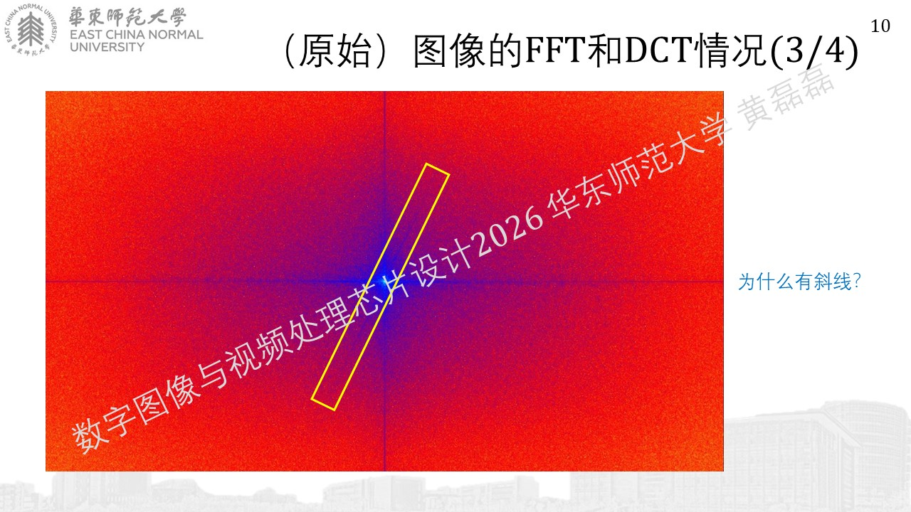
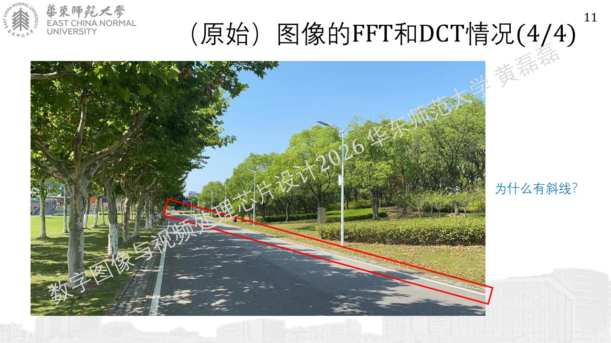

帧内预测的原理
........................................
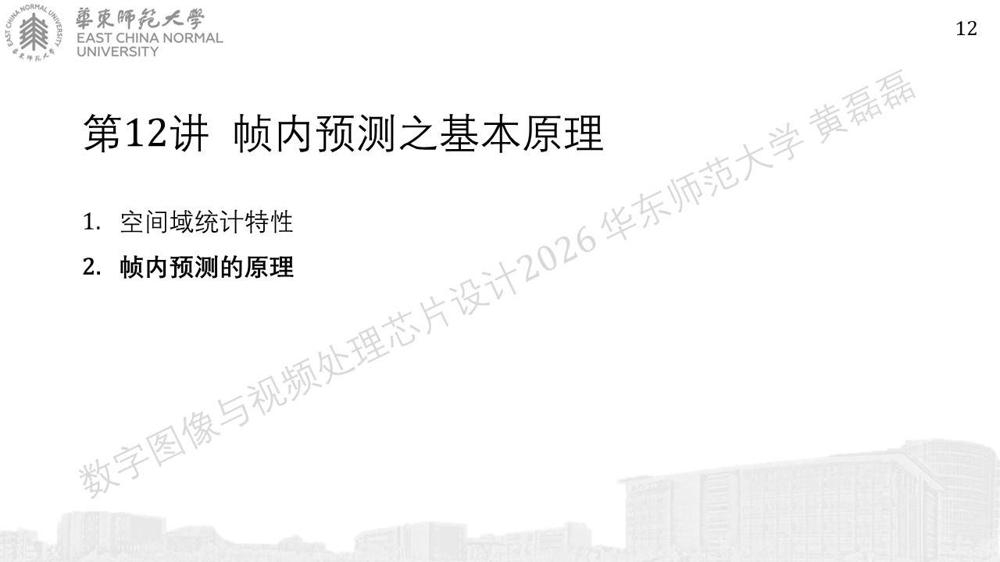
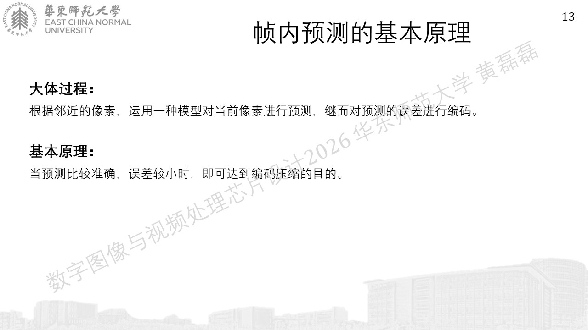
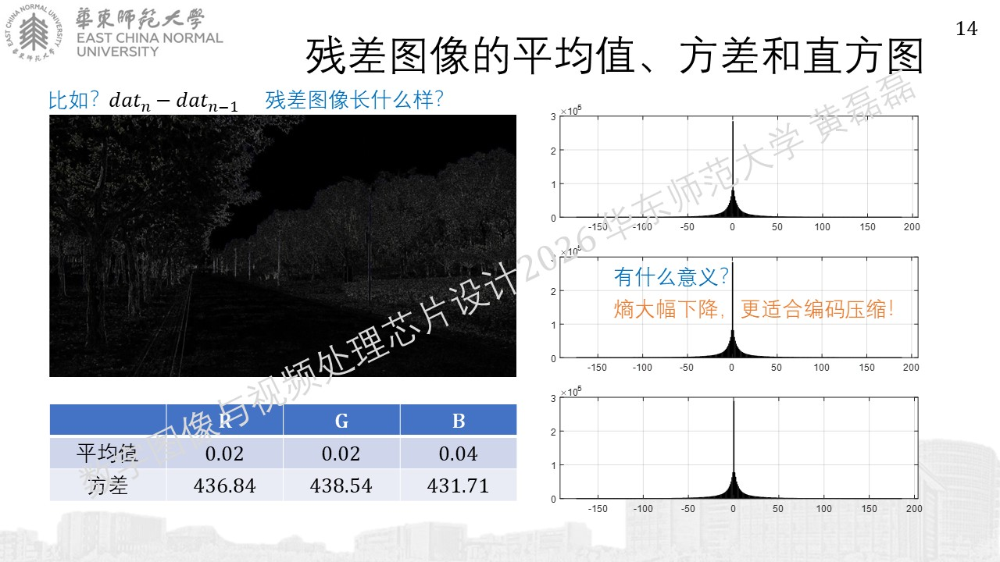

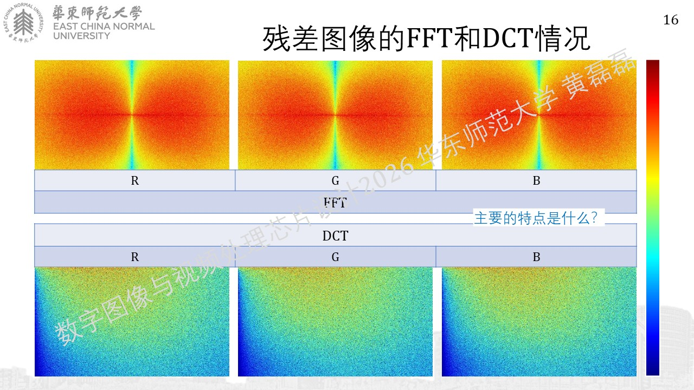
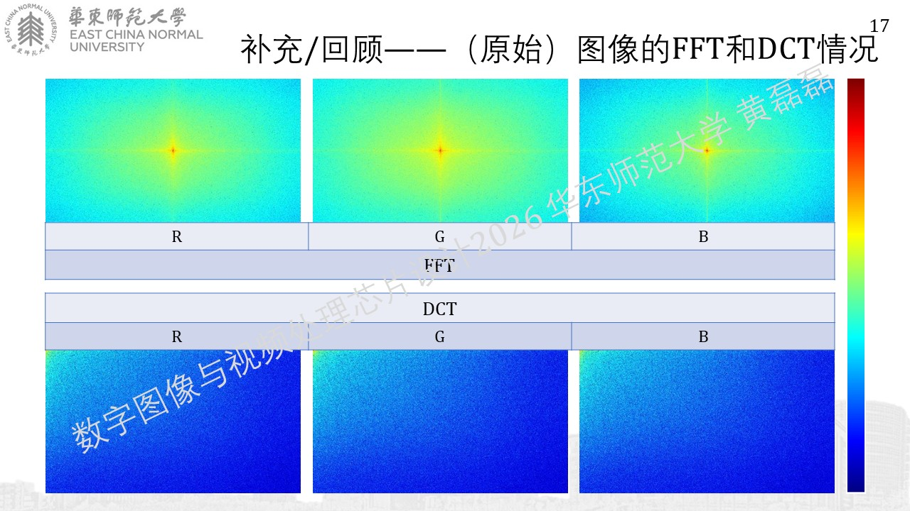
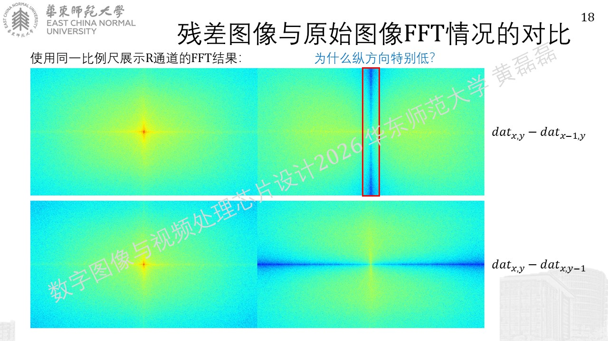
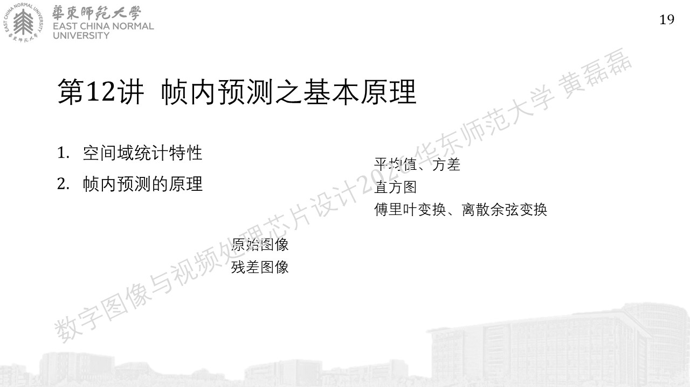
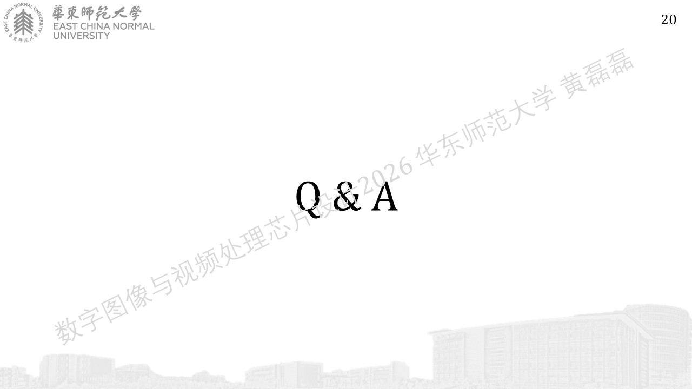
