.. -----------------------------------------------------------------------------
   ..
   ..  Filename       : index.rst
   ..  Author         : Huang Leilei
   ..  Status         : phase 000
   ..  Created        : 2026-09-17
   ..  Description    : description about 第15讲 - 变换量化 - 基本原理
   ..
.. -----------------------------------------------------------------------------

第15讲 - 变换量化 - 基本原理
--------------------------------------------------------------------------------

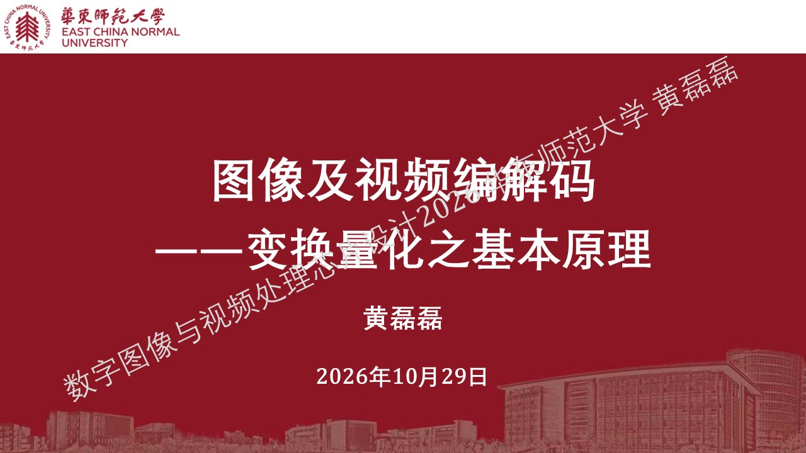

导入
........................................
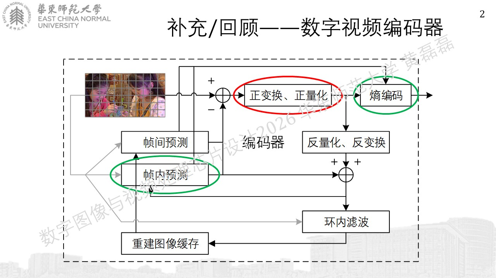

残差图像的统计特性
........................................
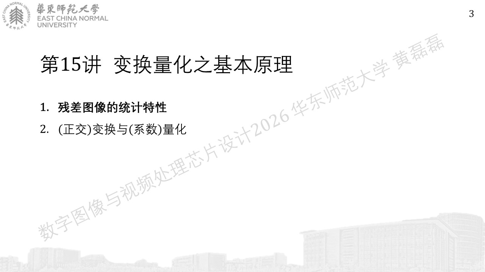
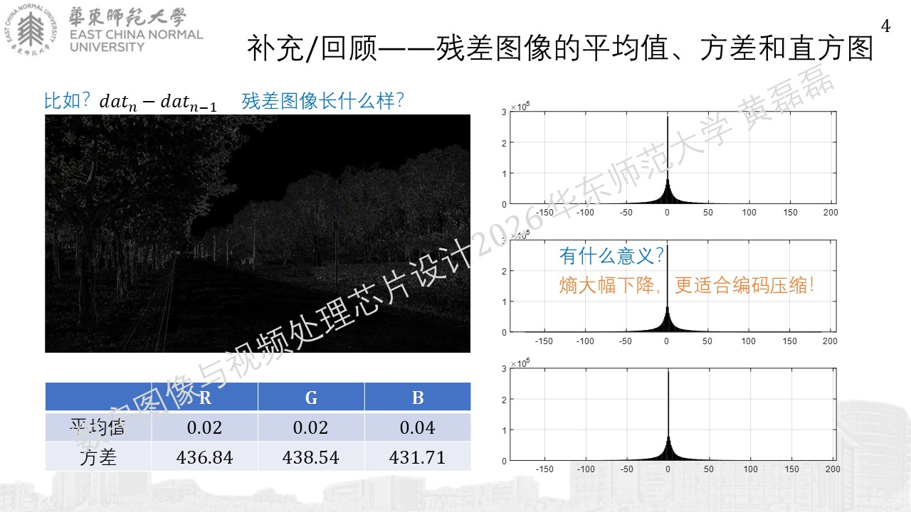
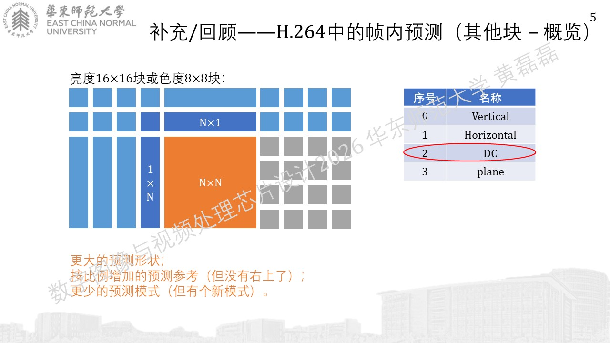
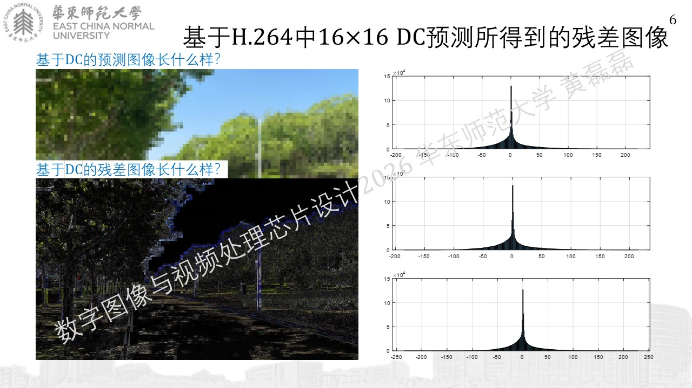
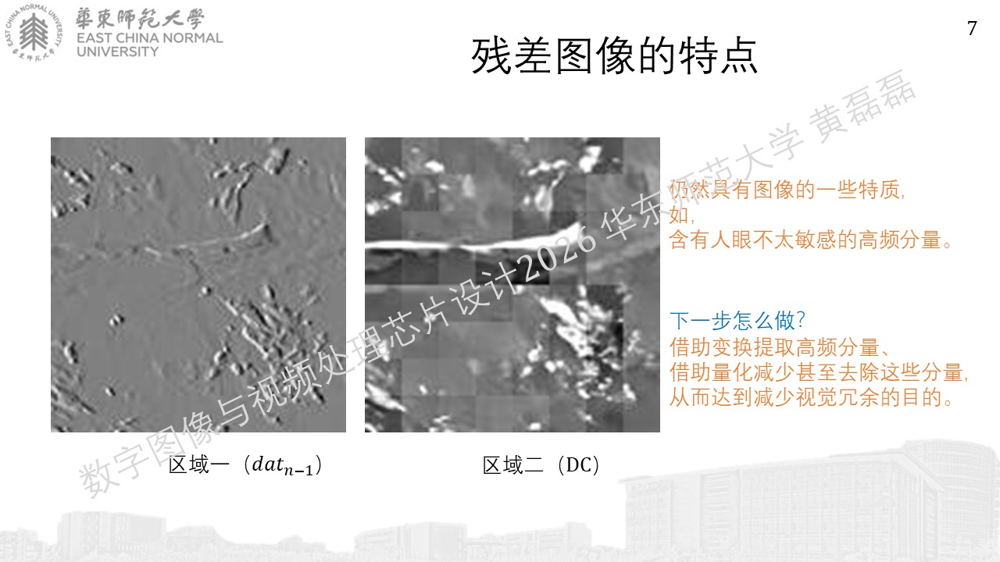

(正交)变换与(系数)量化
........................................
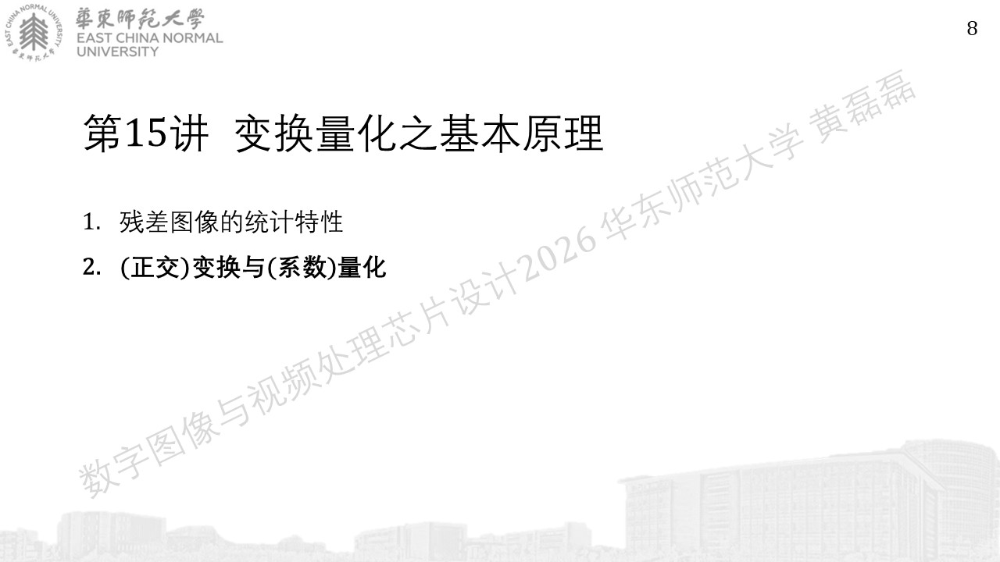
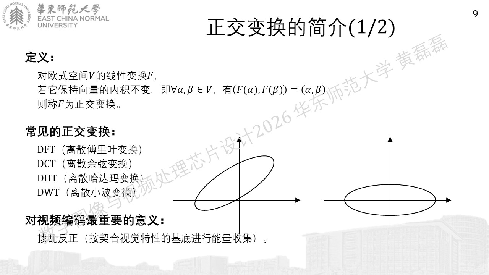
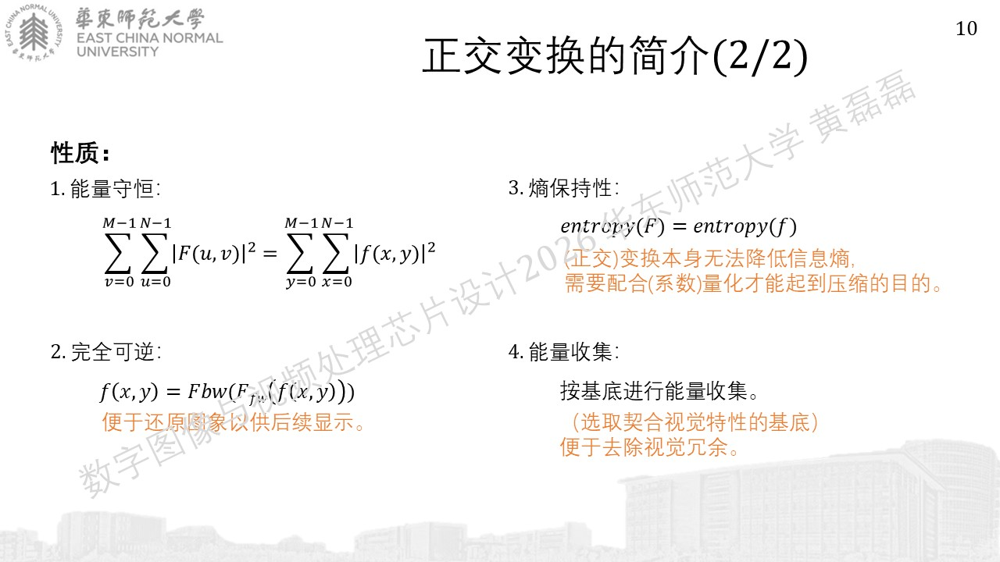
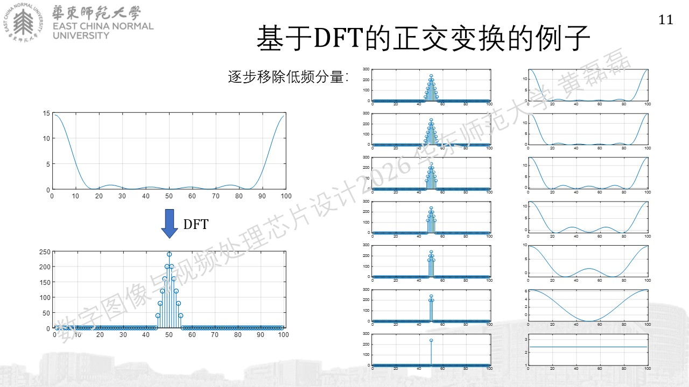
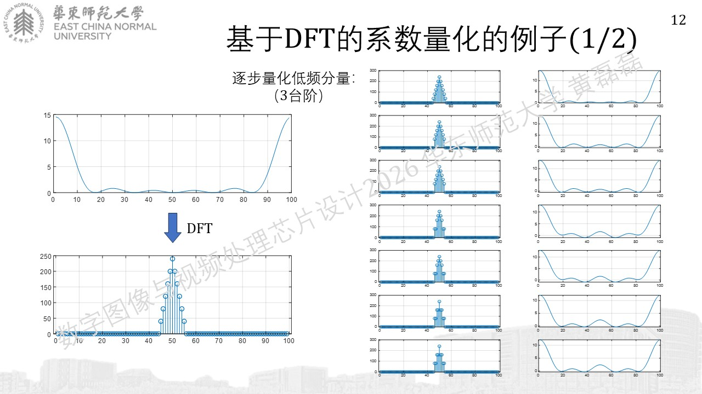

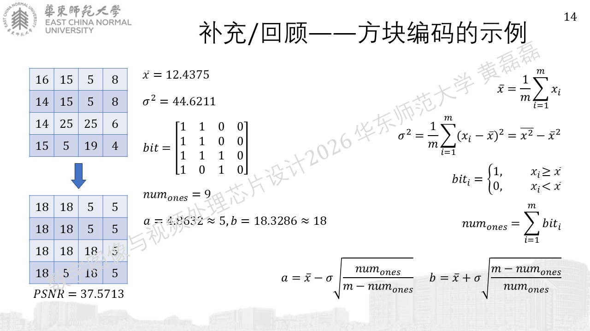
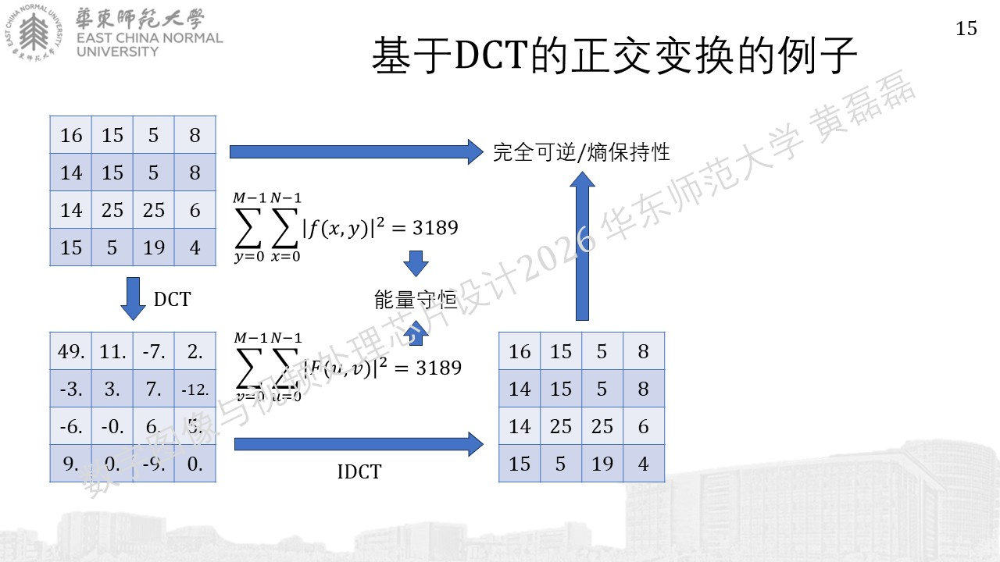
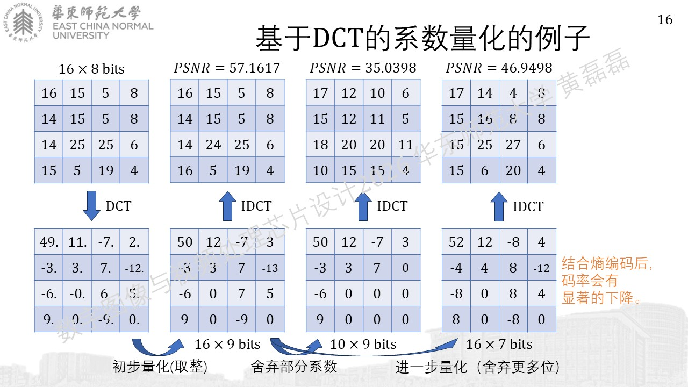
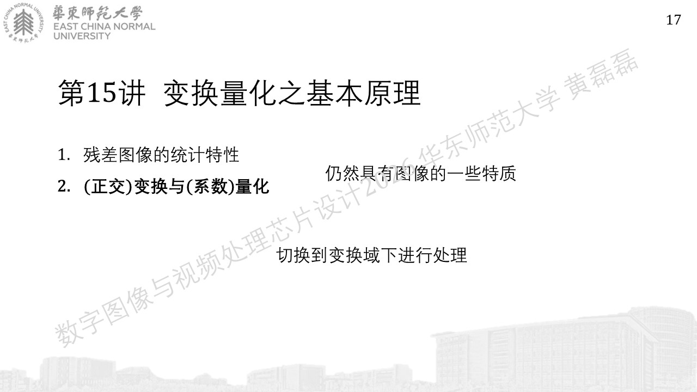
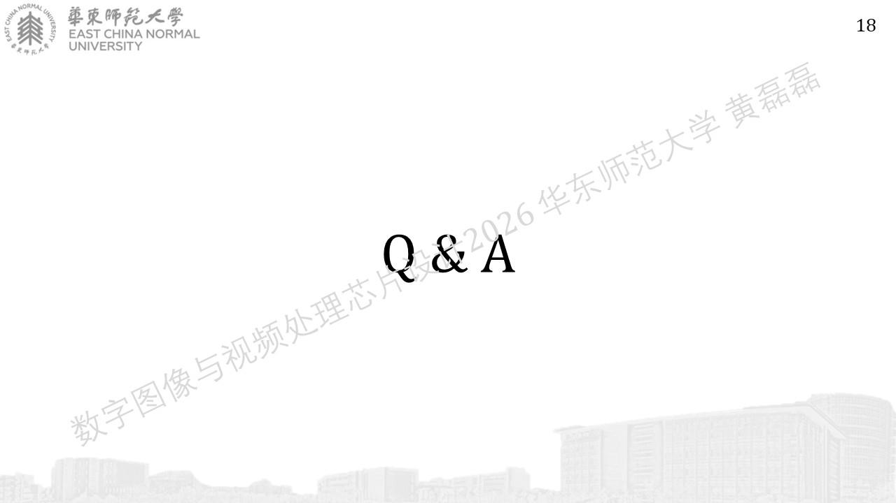
